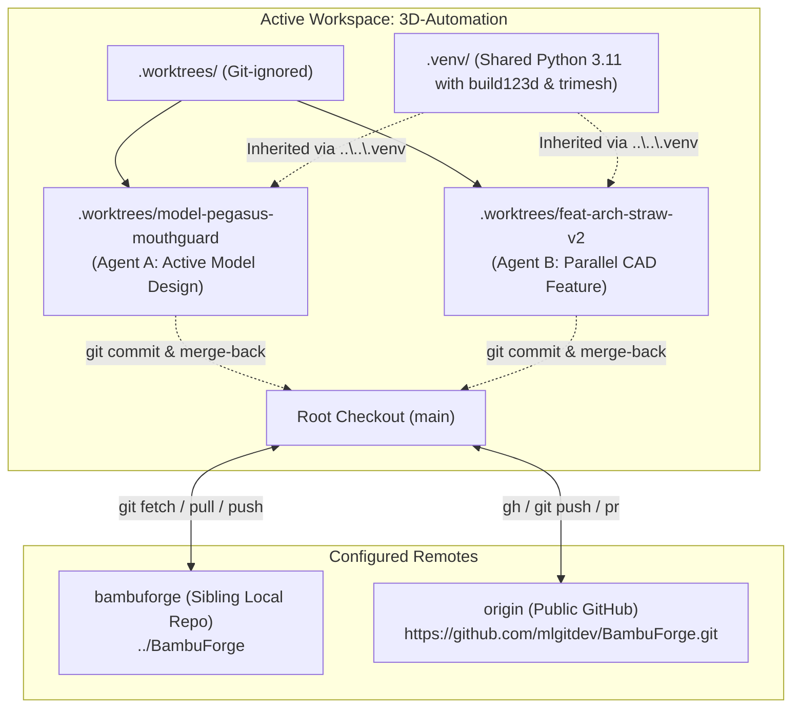

# Git Worktree Task Isolation Skill (`worktree`)

This skill provides multi-agent task isolation using `git worktree` and GitHub CLI (`gh`). It allows multiple AI agents and developers to work simultaneously on 3D models, CAD features, bug fixes, and slicing experiments without interfering with each other, dirtying the root `main` branch, or causing file lock collisions.

---

## 1. When to Use This Skill

Activate this workflow whenever:
1. **Concurrent Agent Active:** Another AI agent is already working inside the repository (e.g. active conversation lock in `presence/` or running CAD generation).
2. **New 3D Model Development:** Designing a new parametric model, style variant, or mesh surgery under `models/<model-name>/`.
3. **Experimental Features / Slicing:** Modifying shared CAD engines (`p2s_cad_helpers.py`, `planter_family_engine.py`, or infill modifier scripts).
4. **Isolated Bug Fixing / Refactoring:** Fixing tolerances or updating skills in an isolated branch before merging back to `main`.

---

## 2. Architecture & Dual-Remote Topology



### Key Principles:
- **Root Checkout is Protected:** Treat the repository root `main` as clean and stable.
- **Shared Python Environment:** Worktrees do not replicate the multi-gigabyte `.venv/`. Scripts running inside `.worktrees/<folder>/` inherit the root virtual environment:
  - Windows: `..\..\.venv\Scripts\python.exe`
  - Linux/macOS: `../../.venv/bin/python`
- **Sibling Remote Awareness:** The sibling directory `../BambuForge` is configured as a remote named `bambuforge`. You can fetch upstream updates directly via `git fetch bambuforge` or `.\scripts\worktree.ps1 sync-remote`.
- **Public GitHub Remote:** The remote `origin` points to `https://github.com/mlgitdev/BambuForge.git` for PR creation via `gh pr create`.

---

## 3. Worktree CLI Commands

### PowerShell (Windows)
```powershell
# 1. Spawn a new isolated worktree
.\scripts\worktree.ps1 new model/<model-name>
# (Or using task runner):
.\build.ps1 -Task worktree-new -Branch model/<model-name>

# 2. List all active worktrees
.\scripts\worktree.ps1 list

# 3. Complete task: merge back into main, remove worktree, AND delete temporary agent branch
.\scripts\worktree.ps1 finish model/<model-name> main

# (Individual sub-steps if needed separately):
.\scripts\worktree.ps1 merge-back model/<model-name> main
.\scripts\worktree.ps1 remove model/<model-name> -DeleteBranch

# 5. Fetch updates from sibling BambuForge remote
.\scripts\worktree.ps1 sync-remote bambuforge

# 6. Prune stale worktree metadata
.\scripts\worktree.ps1 prune
```

### Bash (macOS / Linux)
```bash
# 1. Spawn a new worktree
./scripts/worktree.sh new model/<model-name>

# 2. List active worktrees
./scripts/worktree.sh list

# 3. Remove a worktree
./scripts/worktree.sh remove model/<model-name> [-f]

# 4. Merge back into main
./scripts/worktree.sh merge-back model/<model-name> main

# 5. Sync sibling remote
./scripts/worktree.sh sync-remote bambuforge

# 6. Prune
./scripts/worktree.sh prune
```

---

## 4. Branch & Worktree Naming Conventions

Always use standardized prefixes to maintain clarity across concurrent agent sessions:

| Type | Prefix | Example | Directory Name |
| :--- | :--- | :--- | :--- |
| **New 3D Model** | `model/<descriptor>` | `model/mouthguard-pegasus` | `.worktrees/model-mouthguard-pegasus/` |
| **CAD Feature / Engine** | `feat/<descriptor>` | `feat/arch-straw-v2` | `.worktrees/feat-arch-straw-v2/` |
| **Bug Fix / Tolerance** | `fix/<descriptor>` | `fix/rod-socket-gap` | `.worktrees/fix-rod-socket-gap/` |
| **Sub-task / Experiment** | `sub/<parent>/<task>`| `sub/pegasus/hinge` | `.worktrees/sub-pegasus-hinge/` |
| **Documentation** | `docs/<descriptor>` | `docs/assembly-diagrams` | `.worktrees/docs-assembly-diagrams/` |

---

## 5. End-to-End Agent Lifecycle (Step-by-Step)

When assigned a task while another agent is working or when isolating work:

### Step 1: Check Active Worktrees & Status
```powershell
.\scripts\worktree.ps1 list
```

### Step 2: Spawn Dedicated Worktree
```powershell
.\scripts\worktree.ps1 new model/<model-name>
```

### Step 3: Switch Directory to Worktree
```powershell
cd .worktrees\model-<sanitized-name>
```

### Step 4: Develop & Execute CAD Scripts
Use the inherited root virtual environment:
```powershell
& "..\..\.venv\Scripts\python.exe" models\<model-name>\<model-name>.py
```
Run the 11-point support-free and printability audit:
```powershell
& "..\..\.venv\Scripts\python.exe" .agents\skills\bambu-studio-ai\scripts\analyze.py models\<model-name>\exports\<model-name>.stl
```

### Step 5: Stage & Commit Inside Worktree
```powershell
git status
git add models/<model-name>/
git commit -m "feat(models): add <model-name> parametric CAD and assembly guide"
```

### Step 6: Finish Worktree, Merge to `main` & Delete Temporary Agent Branch
Always merge back into `main`, remove the `.worktrees/*` folder, and delete the temporary agent-created branch so no orphan branches accumulate:
```powershell
cd ..\..
# One-command merge + worktree removal + temporary branch deletion:
.\scripts\worktree.ps1 finish model/<model-name> main
```
If skills, rules, or profiles were also updated, synchronize to `BambuForge` and commit both repositories atomically:
```powershell
python ".agents\skills\bambuforge-repo-sync\scripts\sync_to_bambuforge.py" --bump patch --commit-source --commit-msg "feat(skills): sync <descriptor>"
```
- **Zero Leftover Agent Branches Rule:** Never leave temporary agent-created branches (`model/*`, `feat/*`, `fix/*`, `sub/*`, `docs/*`) behind after merging, and never copy files manually out of a worktree without removing the worktree and deleting the temporary branch. **Never delete branches explicitly created by the user.**

---

## 6. Rules & Best Practices

1. **Never edit files in repository root when running in a worktree:** Ensure your working directory is `.worktrees/<name>/`.
2. **Never duplicate `.venv`:** Always reference `..\..\.venv` from worktrees.
3. **Always prune after removal:** `git worktree prune` keeps the git index clean.
4. **Use `--force` only when sure:** If untracked build artifacts (`.tmp.3mf`) prevent removal, use `-Force`.
