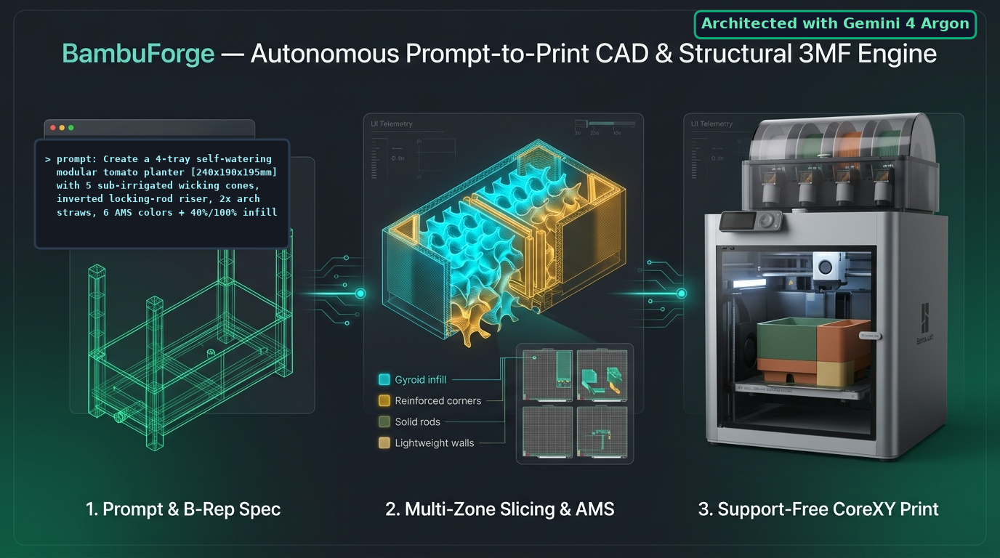
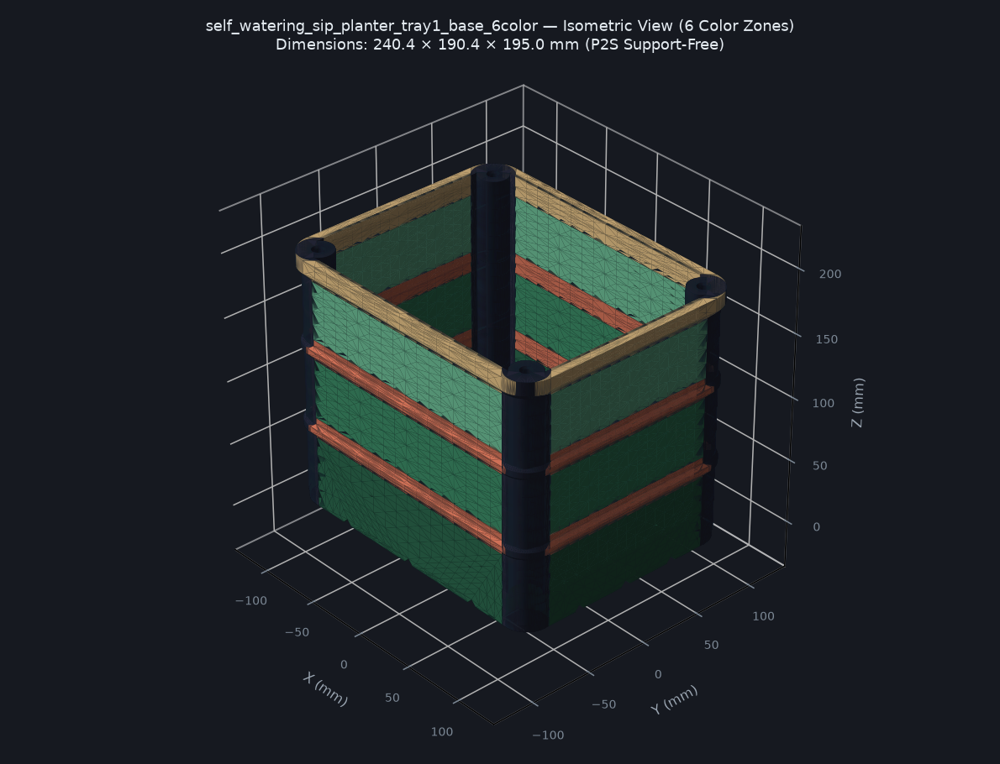
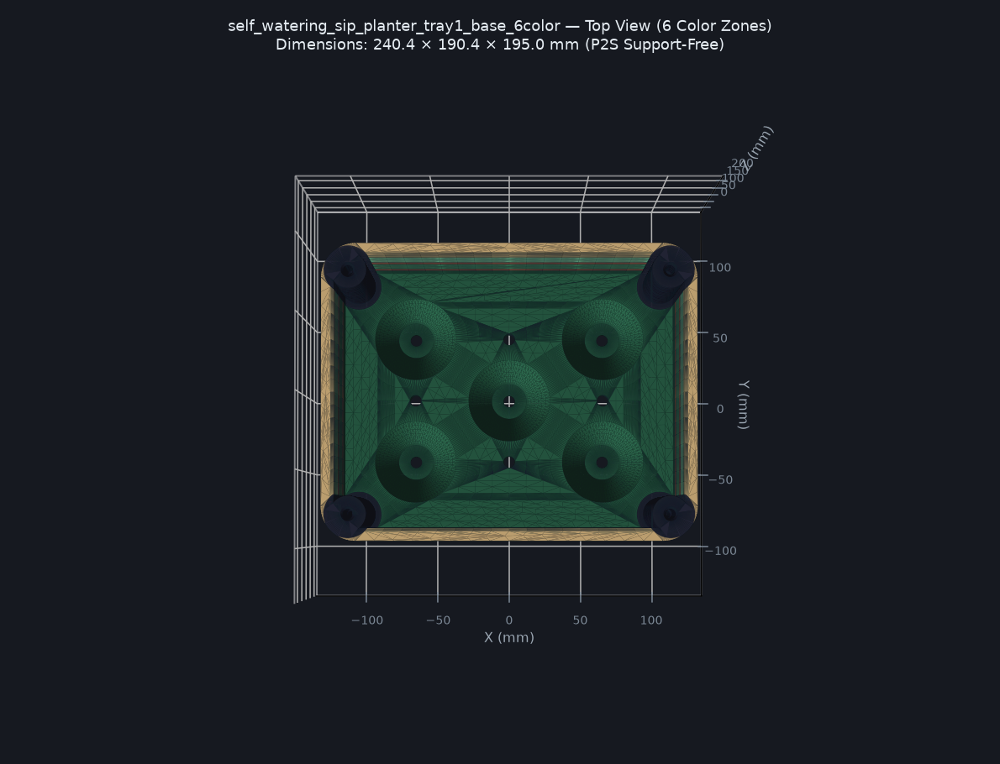

<div align="center">

# BambuForge

### Autonomous Prompt-to-Print B-Rep CAD, Multi-Color AMS & Structural `.3mf` Engine
**Built for Bambu Lab Printers — Portable to Any FDM 3D Printer**

[](#architecture--gemini-4-argon-attribution)
[](https://github.com/mlgitdev/BambuForge/releases)
[](https://github.com/mlgitdev/BambuForge/actions/workflows/ci.yml)
[](https://github.com/mlgitdev/BambuForge/actions/workflows/secret-scan.yml)

[](#3-available-skills--required-vs-optional-toolchain)
[](#2-the-model-creation-process-prompt--cad--slicer--print)
[](./SDD.md)
[](./AGENTS.md#2-bambu-lab-p2s-hardware-profile--constraints)

<br/>



</div>

---

## Overview

**BambuForge** is an open-source, **Specification-Driven Design (SDD)** workspace and AI agent skill suite that turns natural-language prompts (or third-party `.3mf` / `.stl` imports) into **support-free, multi-plate, multi-color, structurally zoned `.3mf` and `.step` projects**.

> **Created with Gemini 4 Argon:** The autonomous CAD-to-slicer workflow, multi-zone B-Rep boolean segmentation engine, 2-column `.3mf` plate packager, per-part structural infill injector, and continuous self-learning architecture (`AGENTS.md` + `.agents/skills/`) in this repository were designed and created using **Gemini 4 Argon**.

Instead of generating low-precision triangle meshes that require heavy support material, **BambuForge** synthesizes true **OpenCascade 8.0 B-Rep solids (`build123d`)**:
- **100% Support-Free by Default (`<= 45°` Rule):** Automatically applies `45°` bottom bed chamfers, teardrop horizontal bores (`> 5 mm`), sacrificial counterbore bridges (`0.20 mm`), and `180°` print-orientation inversion for stackable locking pins.
- **Multi-Color AMS & Multi-Plate `.3mf` Packaging:** Partitions designs into non-overlapping watertight color sub-parts (`1–6+` filament slots) and arranges multi-part modular kits across separate build plates (`Tray 1..N`) inside a single `.3mf` file.
- **Automated Per-Zone Structural Slicing (`20%` / `40%` / `100%` Infill):** Injects per-part `wall_loops`, `sparse_infill_density`, `sparse_infill_pattern` (`gyroid`), and native **`<part subtype="modifier_part">` `100%` solid infill meshes** directly into `Metadata/model_settings.config` so high-stress corners (`40%` Gyroid + `4` walls) and connecting rods/sockets (`100%` solid infill + `4` walls) are reinforced automatically when opened in **Bambu Studio** or **OrcaSlicer**.
- **Mandatory Illustrated Assembly & Usage Guides:** Every model folder generates a standalone `ASSEMBLY_GUIDE.md` paired with rendered 3D cutaway/exploded diagrams (`previews/*_assembly_guide.png`) and an interactive Three.js browser viewer (`*_viewer.html`).

For the complete formal engineering specification of all agent rules and skills, see [**`SDD.md` (Spec-Driven Design Document)**](./SDD.md).

---

## 🤖 How to Use with Agentic AI (Clone & Prompt)

**BambuForge is engineered specifically to be driven by Agentic AI** (Google Antigravity, Claude Code, Cursor, Copilot Workspace, Windsurf, Codex, etc.). 

You do **not** need to manually edit configuration files, tolerances, or CAD scripts. Once you clone this repository into your workspace, open your AI coding assistant and ask:

```text
How do I use this repository?
```
*(or "Help me set up BambuForge for my 3D printer")*

### The Agentic Onboarding Flow
1. **Interactive Hardware Calibration:** Your AI agent will inspect [`AGENTS.md`](./AGENTS.md) and immediately respond with:
   > **"What printer and model do you have?"**
2. **Automated Fine-Tuning:** Simply reply with your printer (e.g. *Bambu Lab X1C*, *P1S*, *P2S*, *A1*, *A1 Mini*, *Prusa MK4 / XL*, *Voron 2.4*, *Ender 3*, *Elegoo Neptune*, etc.), your nozzle diameter (`0.4 mm` default), and whether you have multi-material / AMS units.
3. **Instant Self-Configuration:** The agent automatically fine-tunes [`AGENTS.md`](./AGENTS.md), recalibrates the build volume envelope, configures slicing profiles, and generates a personalized quick-start guide so you can immediately begin prompting for custom 3D models!

---

## 1. Repository Structure

```text
BambuForge/
├── AGENTS.md                          # Master agent rules, printer envelope, tolerances & model registry
├── SDD.md                             # Specification-Driven Design (SDD) technical architecture document
├── README.md                          # Product guide, printer configuration, toolchain table & showcase
├── requirements.txt                   # Python dependencies (build123d, trimesh, numpy, matplotlib, pillow)
├── assets/                            # Hero banner and showcase visual diagrams
├── imports/                           # Strictly READ-ONLY input folder for downloaded .3mf / .stl models
├── .agents/
│   └── skills/
│       ├── 3d-print-modeling/         # Skill 1: Parametric B-Rep CAD, mesh surgery & .3mf helper library
│       ├── bambu-studio-ai/           # Skill 2: Multi-plate .3mf packaging, 11-point analyzer & CAD handoff
│       └── self-learning-cad/         # Skill 3: Continuous preference calibration & /learn workflow
├── examples/
│   └── 04-self-watering-sip-wicking-planter/ # Flagship 4-Tray, 6-Color self-watering planter showcase
└── models/
    └── <your-model-name>/             # Every new model is generated in its own isolated subdirectory
```

---

## 2. The Model Creation Process (`Prompt -> CAD -> Slicer -> Print`)

1. **Pre-Design Context Load (`AGENTS.md` + `learned-preferences.md`):**
   The agent reads [`AGENTS.md`](./AGENTS.md) and [`.agents/skills/self-learning-cad/references/learned-preferences.md`](./.agents/skills/self-learning-cad/references/learned-preferences.md) to enforce your printer's build volume, nozzle-multiple wall thicknesses, calibrated clearance tolerances, and support-free geometry rules.
2. **Parametric B-Rep Synthesis or Read-Only `imports/` Mesh Surgery:**
   - **New Models:** Written as clean, `@dataclass`-driven Python `build123d` scripts inside `models/<model-name>/<model-name>.py` and partitioned via boolean algebra (`&`, `-`, `+`) into distinct color and structural zones.
   - **Modified Third-Party Models (`imports/`):** Files placed in `imports/` are treated as **strictly read-only input**. Container height/dimension adjustments use plane-split piecewise-linear Z-mapping so top lid rebates and bottom mechanisms stay `100%` undistorted.
3. **Multi-Plate Packaging & Structural Infill Injection (`p2s_cad_helpers.py`):**
   Exports native `.step`, `.stl`, and a verified multi-plate `.3mf` with pre-assigned AMS colors (`1..6`), 2-column plate grid coordinates, per-zone Gyroid infill (`20%` panels, `35%` belts, `40%` corners), and `100%` solid infill modifier volumes on connecting rods and sockets.
4. **11-Point Printability Audit & Visual Assembly Guide Generation:**
   Runs `analyze.py` (verifying manifold watertightness, `Z = 0` bed contact, and `<= 45°` support-free overhangs), renders 4-view shaded PNGs + an interactive HTML viewer, and generates `ASSEMBLY_GUIDE.md` with 3D cutaway/exploded diagrams.

---

## 3. Available Skills & Toolchain Table (Required vs. Nice-to-Have)

### A. Built-In Agent Skills (`.agents/skills/`)

| Skill Name | Path | Core Responsibilities |
| :--- | :--- | :--- |
| **`3d-print-modeling`** | [`.agents/skills/3d-print-modeling/SKILL.md`](./.agents/skills/3d-print-modeling/SKILL.md) | Parametric `build123d` B-Rep modeling, support-free `<= 45°` geometry helpers (`p2s_cad_helpers.py`), multi-color boolean segmentation, read-only `imports/` mesh surgery, and illustrated `ASSEMBLY_GUIDE.md` generation. |
| **`bambu-studio-ai`** | [`.agents/skills/bambu-studio-ai/SKILL.md`](./.agents/skills/bambu-studio-ai/SKILL.md) | 2-column multi-plate `.3mf` packaging, recursive JSON profile flattening, 6-filament `--load-filaments` injection, per-part/modifier-mesh infill injection, 11-point printability/overhang auditing (`analyze.py`), and slicer/CAD handoff. |
| **`self-learning-cad`** | [`.agents/skills/self-learning-cad/SKILL.md`](./.agents/skills/self-learning-cad/SKILL.md) | Captures dimensional fit adjustments, slicer edge cases, and design preferences into `learned-preferences.md` and `AGENTS.md` via interactive `/learn` proposals. |

### B. Software & Tools Needed (`Required` vs. `Nice-to-Have / Optional`)

| Tool / Package | Status | Purpose in Workflow | Installation / Notes |
| :--- | :--- | :--- | :--- |
| **Python `3.11+`** | **Required** | Runs the `build123d` OpenCascade B-Rep kernel, mesh surgery, analyzer, and preview renderers. | `python -m venv .venv && pip install -r requirements.txt` |
| **`build123d` (`>=0.13`) + `trimesh` + `matplotlib`** | **Required** | Core Python CAD & geometry libraries installed inside `.venv`. | Installed automatically via `requirements.txt`. |
| **Bambu Studio** *(or **OrcaSlicer**)* | **Required for Multi-Plate `.3mf` CLI** | Slices `.step`/`.3mf` files and executes headless `--export-3mf` multi-plate verification & OpenGL thumbnail generation. | [Bambu Studio](https://bambulab.com/en/download/studio) or [OrcaSlicer](https://github.com/SoftFever/OrcaSlicer). *(Without it, `.step`, `.stl`, and single-mesh `.3mf` exports still work 100% standalone).* |
| **FreeCAD `1.1+`** | **Nice-to-Have (Optional)** | Visual B-Rep CAD inspection and interactive solid editing of exported `.step` assemblies. | Optional; launch via `bambu_handoff.py --app freecad --open <file.step>`. |
| **CADCraft** (`storytold/cadcraft`) | **Nice-to-Have (Optional)** | Pure-Rust AutoCAD-style 2D `.dxf`/`.scr` drafting tool with built-in MCP server (`cadcraft-cli mcp --launch`). | Optional; useful for drafting 2D `.dxf` profiles to extrude in `build123d`. |
| **Web Browser (Chrome / Edge / Firefox)** | **Built-In / Standard** | Opens the generated interactive Three.js 3D viewers (`previews/*_viewer.html`) with zero install. | Double-click any `*_viewer.html` file. |

---

## 4. Defining Your Bambu Lab Printer & Porting to Any 3D Printer

### A. Configuring Any Bambu Lab Printer (`P2S`, `X1C`, `P1S`, `P1P`, `A1`, `A1 Mini`, `H2D`)

By default, **BambuForge** is configured for the **Bambu Lab P2S (`256 × 256 × 256 mm`, `0.4 mm` nozzle)**. To switch to another Bambu Lab model:

1. **Update Hardware Dimensions in [`AGENTS.md`](./AGENTS.md) & [`analyze.py`](./.agents/skills/bambu-studio-ai/scripts/analyze.py):**
   - **X1C / P1S / P1P / A1:** Keep `P2S_BUILD_VOLUME = (256.0, 256.0, 256.0)`.
   - **A1 Mini:** Set `P2S_BUILD_VOLUME = (180.0, 180.0, 180.0)` and `P2S_SAFE_VOLUME = (174.0, 174.0, 174.0)`.
   - **H2D:** Set `P2S_BUILD_VOLUME = (350.0, 320.0, 325.0)`.
2. **Set Your Machine Profile Name (Optional Environment Override):**
   In [`.agents/skills/3d-print-modeling/scripts/p2s_cad_helpers.py`](./.agents/skills/3d-print-modeling/scripts/p2s_cad_helpers.py), you can override the default machine/process/filament profile names via environment variables or constants:
   ```powershell
   $env:BAMBU_MACHINE_PROFILE = "Bambu Lab X1 Carbon 0.4 nozzle.json"
   $env:BAMBU_PROCESS_PROFILE = "0.20mm Standard @BBL X1C.json"
   ```

### B. How to Port BambuForge to Any Other 3D Printer (Prusa, Voron, Creality, Klipper)

Because **BambuForge** generates standard **ISO-10303 `.step` B-Rep solids**, **watertight `.stl` meshes**, and **3MF Core / Production `.3mf` assemblies**, porting to any non-Bambu FDM printer takes 3 simple steps:

1. **Option 1 — Using OrcaSlicer (Drop-In Multi-Plate `.3mf` Compatibility for Voron, Prusa, Creality, RatRig):**
   - **OrcaSlicer** shares the exact same `.3mf` multi-plate grid (`Metadata/model_settings.config`, `<part subtype="modifier_part">`, and `--export-3mf` CLI flags) as Bambu Studio!
   - Point `BAMBU_STUDIO_EXE` to `orcaslicer.exe` (or `/Applications/OrcaSlicer.app/Contents/MacOS/OrcaSlicer`) and select your printer's JSON profile in OrcaSlicer's `resources/profiles/` directory.
2. **Option 2 — Using PrusaSlicer / SuperSlicer / Cura:**
   - Open any generated multi-body **`.step`** (`exports/<tray_name>.step`) or **`.3mf`** file directly in PrusaSlicer.
   - PrusaSlicer loads the multi-body `.step` assembly with all color/structural sub-parts aligned in place—assign extruders or right-click any sub-part (`Corner_Columns`, `Locking_Rods`) to apply per-part infill and perimeter overrides.
3. **Adjust Build Plate Stride & Overhang/Tolerance Constants (If Needed):**
   - Update `P2S_BUILD_VOLUME` in [`analyze.py`](./.agents/skills/bambu-studio-ai/scripts/analyze.py) to match your bed size (e.g., `(250.0, 210.0, 220.0)` for Prusa MK4S or `(350.0, 350.0, 350.0)` for Voron 2.4).
   - Tune the **Calibrated Tolerances & Fit Table** in [`AGENTS.md`](./AGENTS.md) after printing a quick test fit on your machine.

---

## 5. Flagship Showcase: `04-self-watering-sip-wicking-planter`

Included in [`examples/04-self-watering-sip-wicking-planter/`](./examples/04-self-watering-sip-wicking-planter/) is a complete, multi-tray, multi-color engineering showcase generated by **BambuForge**.

### A. The Natural-Language Prompt That Generates This Result

```text
Create a modular cherry tomato planter system optimized for my 256×256×256 mm printer with zero supports (<= 45° overhangs):
1. Style: Sub-Irrigated Self-Watering (SIP) Wicking Planter (240.4 × 190.4 × 195.0 mm) with an elevated sub-irrigation floor (Z = 23 mm) and 5 deep funnel-shaped wicking cones extending down to Z = 5 mm, where the 4 outer wicking cones are centered at (±64, ±42 mm) concentric with the Ø8.0 mm floor holes.
2. Trellis Support: 4 reinforced corner columns with dual-stage sockets for 6 mm metal stakes or 4 mm through-wires/strings.
3. Tray 2 (Plate 2): A watertight drip/reservoir saucer with raised internal aeration rails.
4. Tray 3 (Plate 3): A stackable deep-root extension riser with 4 integrated male locking rods printed as part of the riser—orient the riser inverted 180° on its flat top rim at Z = 0 so the 4 locking rods print pointing straight up (+Z) with zero supports.
5. Tray 4 (Plate 4): 2× 3D-printed sub-soil perforated irrigation arch straws (128 mm span, Ø7.4 mm stepped floor intake plugs, hollow Ø5.0 mm bore for a cotton capillary wick strip, and 15 angled root-watering slits).
6. Multi-Color & Structural Slicing: Partition Tray 1 into 6 color zones, Tray 2 into 1 color, Tray 3 into 4 color zones, and Tray 4 into 2 color zones. Pre-configure the .3mf with 3 walls + 20% Gyroid infill on main panels, 4 walls + 40% Gyroid on the 4 corner columns, and 4 walls + 100% solid infill modifier meshes on the locking rods, corner rod sockets, and arch straws. Generate an illustrated ASSEMBLY_GUIDE.md explaining how to thread a cotton cloth strip through the arch straws and assemble all 4 trays.
```

### B. Visual Gallery (Generated Automatically by the Pipeline)

<div align="center">


| Isometric View (6-Color Base Planter) | Top-Down View (Concentric `(±64, ±42)` Wicking Cones) |
| :---: | :---: |
|  |  |

</div>

### C. Complete Manifest of Files Created by the Pipeline

Running `python examples/04-self-watering-sip-wicking-planter/self_watering_sip_planter.py` creates the following structured deliverable inside the model folder:

| File / Directory | Format | Description |
| :--- | :--- | :--- |
| **`self_watering_sip_planter.py`** | Python (`build123d`) | Parametric B-Rep source script invoking `planter_family_engine.py`. |
| **`ASSEMBLY_GUIDE.md`** | Markdown | Shareable product manual with pre-configured per-zone slicing table, filament material guide (`PETG`/`PLA`/`ASA`/`ABS`), and step-by-step cotton wick + arch straw assembly instructions. |
| **`exports/self_watering_sip_planter_3_trays_multicolor.3mf`** | **Bambu Studio `.3mf`** | **Master 4-Plate, 6-Color `.3mf` Project** containing Tray 1 (Base), Tray 2 (Saucer), Tray 3 (Inverted Riser), and Tray 4 (2× Arch Straws) with embedded `20%`/`35%`/`40%` Gyroid infill and `100%` solid rod/socket modifier meshes. |
| **`exports/*_tray1..4_*.step`** | ISO-10303 `.step` | 4 native OpenCascade B-Rep multi-body `.step` assemblies for arc slicing (`G2`/`G3`) or direct editing in FreeCAD 1.1. |
| **`exports/*_tray1..4_*.stl`** | Binary `.stl` | 4 watertight merged meshes (`0` non-manifold edges) for each tray. |
| **`exports/color_zones/*.stl`** | Binary `.stl` (`13` files) | Individual watertight meshes for each of the `6 + 1 + 4 + 2 = 13` color/structural zones. |
| **`previews/*_iso / _front / _right / _top.png`** | Shaded PNG (`16` files) | 4-angle shaded CAD renders for every tray. |
| **`previews/assembly_and_straw_guide.png`** | Shaded 3D PNG | 3-panel exploded & X-ray cutaway assembly diagram showing the cotton wick strip path, floor hole seating, and `180°` riser stacking. |
| **`previews/*_viewer.html`** | Interactive HTML (`4` files) | Standalone Three.js 3D multi-color orbit viewers with P2S build-volume cage toggle. |
| **`previews/analysis_report.md` & `.json`** | Markdown / JSON | 11-point printability, bed contact, and `<= 45°` support-free overhang verification report. |

---

## 6. Quick Start

```bash
# 1. Clone the repository and create a Python 3.11+ virtual environment
git clone https://github.com/<your-org>/BambuForge.git
cd BambuForge
python -m venv .venv

# Activate virtual environment (Windows PowerShell)
.\.venv\Scripts\Activate.ps1
# Or on macOS / Linux: source .venv/bin/activate

# 2. Install CAD & mesh dependencies
pip install -r requirements.txt

# 3. Run the flagship 04 Self-Watering Planter generator
python examples/04-self-watering-sip-wicking-planter/self_watering_sip_planter.py

# 4. Run the 11-point support-free printability analyzer
python .agents/skills/bambu-studio-ai/scripts/analyze.py examples/04-self-watering-sip-wicking-planter/exports/self_watering_sip_planter_tray1_base_6color.stl
```

---

## License & Attribution

- **Process & Agentic Architecture:** Engineered with **Gemini 4 Argon**.
- **License:** MIT License — free to use, modify, and adapt for any 3D printer.
