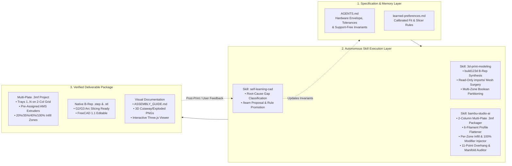

# Specification-Driven Design (SDD) — BambuForge Autonomous CAD-to-3MF Architecture

> **System Name:** **BambuForge**
> **Architecture & Process Engineered With:** **Gemini 4 Argon**
> **Target Domain:** Autonomous Parametric B-Rep CAD Generation, Third-Party Mesh Surgery, Multi-Color AMS Segmentation, Per-Zone Structural Slicing & Support-Free 3D Print Verification

---

## 1. Executive Summary & Architectural Vision

**BambuForge** is a **Specification-Driven Design (SDD)** agentic framework that bridges natural-language engineering requirements directly to production-ready, multi-plate, multi-color, structurally optimized `.3mf` and `.step` files.

Unlike cloud text-to-mesh generators that produce non-manifold, low-precision triangle soups requiring heavy support structures, **BambuForge** operates as a deterministic local engineering compiler powered by **OpenCascade 8.0 (`build123d`)**, **Trimesh topological surgery**, and **headless Slicer CLI orchestration**:

1. **Zero-Support Geometric Invariants (`<= 45°`):** Every feature—from horizontal bores to stackable male locking pins and sub-soil irrigation arches—is mathematically constrained or print-orientation inverted (`180°`) so the entire project prints with `enable_support = 0`.
2. **Multi-Color & Multi-Zone B-Rep Boolean Partitioning:** Models are partitioned via exact B-Rep boolean algebra (`&`, `-`, `+`) into watertight sub-assemblies that serve both **multi-color AMS aesthetics** (up to 6+ filament slots) and **localized structural reinforcement**.
3. **Automated Per-Part Slicing & Modifier Mesh Injection:** The `.3mf` packager embeds per-zone `wall_loops`, `sparse_infill_density`, `sparse_infill_pattern` (`gyroid`), and native **`<part subtype="modifier_part">` `100%` solid infill volumes** directly into `Metadata/model_settings.config`.
4. **Closed-Loop Self-Learning (`self-learning-cad`):** Dimensional tolerances, slicer quirks, and workflow refinements are captured into `learned-preferences.md` and `AGENTS.md`, preventing regression across sessions.

---

## 2. System Architecture & Agent-Skill Topology

---

## 3. Core Agent Capabilities (`AGENTS.md` Specification)

The root [`AGENTS.md`](./AGENTS.md) acts as the single source of truth governing agent behavior:

### 3.1 Hardware Envelope & Extrusion Quantization
* **Build Volume Enforcement:** Default `256 × 256 × 256 mm` (Bambu Lab P2S / X1C / P1S / A1), with a `250 × 250 × 250 mm` safe single-part envelope.
* **Nozzle-Multiple Wall Quantization (`0.4 mm` Nozzle):**
  * Cosmetic / Light: `1.25–1.29 mm` (`3` perimeter walls)
  * Functional / Watertight: `1.65–1.74 mm` (`4` perimeter walls)
  * Heavy Structural: `2.50–4.20 mm` (`6+` perimeter walls or `3–4` walls + Gyroid core)
* **Layer-Multiple Z-Steps (`0.20 mm` Standard Layer):** All horizontal ledges, floor thicknesses (`5.0 mm = 25 layers`), and sacrificial counterbore bridges (`0.20 mm = 1 layer`) are integer multiples of the layer height.

### 3.2 Support-Free Geometric Invariants (`enable_support = 0`)
1. **Overhang Angle Bound:** Every downward-facing surface normal $\mathbf{n} = (n_x, n_y, n_z)$ above the build plate (`Z > 0.25 mm`) must satisfy:
   $$\theta_{\text{vertical}} = \arcsin(|n_z|) \le 45^\circ \quad (\text{i.e., } n_z \ge -\frac{\sqrt{2}}{2} \approx -0.7071)$$
2. **Bed Contact Edge Treatment (`Z = 0`):** Fillets on bottom horizontal edges are prohibited (their tangent approaches $90^\circ$ overhang at layer 1–3). Vertical edges are filleted first (`edges().filter_by(Axis.Z)`), followed by a `45°` `chamfer()` (`0.8–1.5 mm`) on the `Z = 0` face loop.
3. **Horizontal Bore Compensation (`Ø > 5.0 mm`):** Circular horizontal holes `> 5 mm` are replaced by `make_teardrop_cylinder()` (a `45°` pointed or truncated roof) or an octagonal/diamond cross-section so the crown bridges cleanly.
4. **Print-Orientation Inversion (`180°` Flip for Interlocking Pins):** Modules requiring downward-protruding male alignment pins (such as the **Stackable Deep-Root Extension Riser**) are designed with a flat top rim and exported inverted `180°` so the flat top rim sits on `Z = 0` and the 4 locking rods print pointing straight UP (`+Z`) above a `45°` conical transition.

---

## 4. Detailed Skill Specifications

### 4.1 Skill 1: `3d-print-modeling` (`.agents/skills/3d-print-modeling/`)

#### A. B-Rep Context Isolation & Boolean Partitioning
* **Context Isolation Rule:** In `build123d`, opening a nested `with BuildPart():` inside a helper function resets the active builder context. All helper solids (`make_profile_band`, `make_dual_rod_cutter`, `make_bottom_runoff_arch`) are constructed in standalone `BuildPart` scopes and combined via explicit boolean operators (`+` union, `-` subtraction, `&` intersection).
* **Multi-Zone Watertight Segmentation:** A monolithic `Part` is partitioned into $K$ non-overlapping B-Rep zones $Z_1, Z_2, \dots, Z_K$ such that:
  $$\bigcup_{i=1}^{K} Z_i = P_{\text{master}}, \quad \text{Vol}(Z_i \cap Z_j) = 0 \;\;\forall i \neq j$$
  This guarantees zero coplanar z-fighting in Bambu Studio while allowing each zone $Z_i$ to receive an independent **AMS Extruder ID (`1..6`)** AND independent **Structural Slicing Parameters** (`wall_loops`, `sparse_infill_density`, `sparse_infill_pattern`).

#### B. Read-Only `imports/` & Piecewise-Linear Mesh Surgery
When modifying third-party `.3mf` or `.stl` models placed in `imports/<folder>/`:
1. **Read-Only Contract:** `imports/` is never modified; all derived code and exports are written to `models/<model-name>/`.
2. **Feature-Preserving Mid-Section Resizing:** To change the height of an imported container from $H_0$ to $H_1$ (`delta = H_1 - H_0`) without distorting bottom mechanical mounts ($z \in [0, z_{\text{low}}]$) or top snap-fit lid rebates ($z \in [z_{\text{high}}, H_0]$):
   * First, split all mesh triangles intersecting the horizontal planes $z = z_{\text{low}}$ and $z = z_{\text{high}}$ via `trimesh.intersections.slice_faces_plane()`.
   * Apply the continuous piecewise-linear Z-transformation:
     $$z' = \begin{cases} z, & z \le z_{\text{low}} \\[4pt] z_{\text{low}} + (z - z_{\text{low}})\,\dfrac{(z_{\text{high}} - z_{\text{low}}) + \Delta H}{z_{\text{high}} - z_{\text{low}}}, & z_{\text{low}} < z < z_{\text{high}} \\[8pt] z + \Delta H, & z \ge z_{\text{high}} \end{cases}$$
   * This preserves `0.000 mm` dimensional error on both the bottom mechanism and the top rebate step.

---

### 4.2 Skill 2: `bambu-studio-ai` (`.agents/skills/bambu-studio-ai/`)

#### A. Multi-Plate 2-Column Grid Coordinate Specification
Bambu Studio arranges `256 × 256 mm` build plates in a **2-column grid** (`m_plate_cols = 2`) with a `307.2 mm` center-to-center stride (`256.0 mm` bed + `51.2 mm` margin). For Plate `k` (`k = 1, 2, ...`):
$$\text{col} = (k - 1) \bmod 2, \quad \text{row} = \lfloor (k - 1) / 2 \rfloor$$
$$X_{\text{center}}(k) = 128.0 + 307.2 \times \text{col}, \quad Y_{\text{center}}(k) = 128.0 - 307.2 \times \text{row}$$
* **Plate 1 (`k = 1`):** `(128.0, 128.0, 0.0)`
* **Plate 2 (`k = 2`):** `(435.2, 128.0, 0.0)`
* **Plate 3 (`k = 3`):** `(128.0, -179.2, 0.0)`
* **Plate 4 (`k = 4`):** `(435.2, -179.2, 0.0)`

#### B. Recursive JSON Profile Flattening & 6-Filament Array Synchronization
* Slicer profile JSONs use `"inherits"` chains (e.g., `Bambu Lab P2S 0.4 nozzle.json` $\to$ `fdm_bbl_3dp_001_common.json`). `_flatten_bambu_json()` recursively resolves the inheritance tree before invoking `bambu-studio --load-settings`.
* To populate a 6-color AMS palette without triggering array-length mismatch faults in `project_settings.config`, 6 flattened filament JSON files are passed via `--load-filaments "f1.json;f2.json;...;f6.json"`.

#### C. Per-Part Structural Slicing & `100%` Infill Modifier Mesh Specification
Inside `Metadata/model_settings.config`, each `<part id="..." subtype="normal_part">` and `<part id="..." subtype="modifier_part">` is injected with explicit process metadata:
* **Main Wall Panels (`normal_part`):** `wall_loops = 3`, `sparse_infill_density = 20%`, `sparse_infill_pattern = gyroid`
* **Horizontal Reinforcing Belts & Rim (`normal_part`):** `wall_loops = 3`, `sparse_infill_density = 35%`, `sparse_infill_pattern = gyroid`
* **4 Corner Trellis Columns (`normal_part`):** `wall_loops = 4`, `sparse_infill_density = 40%`, `sparse_infill_pattern = gyroid`
* **Rod & Socket Connection Zones (`modifier_part`):** Bounding boxes covering the top `28 mm` Base corner sockets and the top `44 mm` Riser locking rods + internal root transitions are injected as `subtype="modifier_part"` with `wall_loops = 4`, `sparse_infill_density = 100%`, `sparse_infill_pattern = rectilinear` (normalized by Bambu Studio to `100%` solid infill).
* **Sub-Soil Perforated Irrigation Arch Straws (`normal_part`):** `wall_loops = 3`, `sparse_infill_density = 100%`.

#### D. 11-Point Printability & Overhang Analyzer (`scripts/analyze.py`)
Audits every exported `.stl` / `.3mf` mesh against 11 quantitative criteria:
1. Triangle count & parser integrity
2. Watertight manifold edge verification (`edge_count == 2` for all edges)
3. Positive signed volume & outward normal winding
4. Connected component island check
5. Printer build volume check (`<= 256 × 256 × 256 mm`)
6. Safe margin check (`<= 250 × 250 × 250 mm`)
7. Build plate seating (`|Z_min| <= 0.05 mm`)
8. First-layer bed contact area (`>= 25.0 mm²`)
9. Aspect ratio stability
10. Support-free overhang area (`> 45°` from vertical `< 5%`)
11. Severe overhang / unbridged ceiling check (`> 60°` from vertical `< 150 mm²`)

#### E. Illustrated Assembly Guide & `computed_zorder=False` Rendering Pipeline
* [`generate_assembly_guides.py`](./.agents/skills/3d-print-modeling/scripts/generate_assembly_guides.py) renders multi-panel 3D cutaway and exploded assembly diagrams (`previews/*_assembly_guide.png`).
* **Z-Order Rendering Invariant:** Matplotlib `Axes3D` subplots are initialized with `computed_zorder=False`, 3D `Poly3DCollection` meshes are assigned `zorder = 1..6`, and 2D callout badges (`ax.text2D`) are assigned `zorder = 100`, preventing 3D geometry from ever occluding instructional callout text.

---

### 4.3 Skill 3: `self-learning-cad` (`.agents/skills/self-learning-cad/`)

1. **Root-Cause Classification:** Categorizes every user adjustment or post-print observation into `tolerance_calibration`, `support_free_geometry`, `structural_strength`, `ergonomics_aesthetics`, or `workflow_organization`.
2. **Proposal-Driven Persistence (`/learn`):** Generates a structured diff proposal before modifying `SKILL.md` or `AGENTS.md`, ensuring only reusable, universal rules (and never one-off model-specific requests or personal chat remarks) are persisted.
