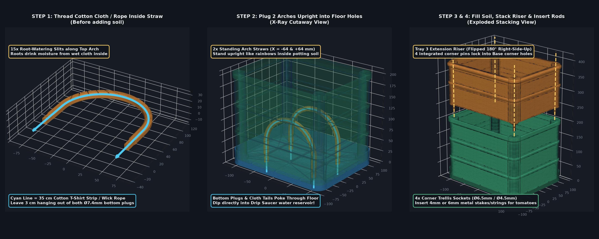

# Assembly, Slicing Settings & Usage Guide — Modular Cherry Tomato Planter + Sub-Soil Irrigation Arch Straws

---

## 1. Parts & Pre-Configured Structural Slicing Settings in Your `.3mf` File

Your `.3mf` project comes **pre-configured with both Global Process Settings and Per-Part / Modifier-Mesh Structural Overrides** (`Metadata/project_settings.config` & `Metadata/model_settings.config`) so every structural zone prints with the right wall count and infill density automatically in **Bambu Studio**:

| Tray / Part Zone in `.3mf` | Wall Loops (`0.4 mm` Nozzle) | Infill Density & Pattern | Top / Bottom Shells | Why This Setting Is Used |
| :--- | :--- | :--- | :--- | :--- |
| **Tray 1 & 3 — Main Wall Panels** (`Color1..3_Box_Layer`, `Color1..2_Riser_Panel`) | **`3` Walls** (`1.29 mm`) | **`20%` Gyroid** | `5` Top / `5` Bottom | Optimal `15–20%` weight-to-strength balance between reinforced ribs; **Gyroid** never crosses itself on the same layer (zero nozzle scraping) and gives 3D isotropic strength. |
| **Tray 1 & 3 — Horizontal Connecting Belts & Top Rim** (`Color4_Connecting_Belts`, `Color5_Top_Rim`, `Color3_Riser_Belts`) | **`3` Walls** (`1.29 mm`) | **`35%` Gyroid** | `5` Top / `5` Bottom |Stiffens the horizontal perimeter rings against outward wet-soil pressure (`10–19 kg` load). |
| **Tray 1 & 3 — 4 Corner Trellis Columns** (`Color6_Corner_Columns`, `Color4_Corner_Columns_And_Stacking_Rods`) | **`4` Walls** (`1.74 mm`) | **`40%` Gyroid** | `5` Top / `5` Bottom | **Heavy-duty `40%` corner reinforcement** + `4` perimeter walls where box corners meet and where the `4 mm` / `6 mm` metal tomato trellis stakes/strings apply bending leverage. |
| **100% Infill Connection Modifiers** (`Modifier_Top_Rod_Sockets_100pct_Infill` & `Modifier_Locking_Rods_And_Root_Joint_100pct_Infill`) | **`4` Walls** (`1.74 mm`) | **`100%` Solid** (`Rectilinear / Cubic`) | `5` Top / `5` Bottom | Embedded Bambu Studio **`modifier_part` meshes** covering the **4 protruding Riser locking rods (`Ø12.1 mm`)**, their `24 mm` internal root transition, and the **top `28 mm` Base corner sockets**—making the assembly joints **100% solid plastic** so they cannot shear or snap! |
| **Tray 2 — Watertight Drip Saucer** (`Color1_Drip_Saucer_Tray`) | **`4` Walls** (`1.74 mm`) | **`25%` Gyroid** | **`5` Top / `5` Bottom** (`1.0 mm`) | `4` walls + `5` solid bottom/top shell layers (`1.0 mm` floor seal) guarantee 100% watertightness so water never weeps onto your floor or balcony. |
| **Tray 4 — 2× Sub-Soil Irrigation Arch Straws** (`Color1_SubSoil_Straw_Arch_Tube`, `Color2_Intake_Plugs`) | **`3` Walls** (`1.29 mm`) | **`100%` Solid** | `5` Top / `5` Bottom | Makes the thin `2.1 mm` arch walls and `Ø7.4 mm` stepped floor intake plugs completely solid and crush-proof under wet potting soil. |

> **How to View or Adjust These Per-Zone Settings in Bambu Studio:**
> In the **Prepare** tab of Bambu Studio, switch the left toggle from **Global** to **Objects**. Each color sub-part and the two `Modifier_*_100pct_Infill` volumes are listed with their `Wall loops` (`3` or `4`) and `Sparse infill density` (`20%`, `35%`, `40%`, or `100%`) icons next to them—click any zone to customize its strength settings if desired.

> [!TIP]
> **Print Speed & Layer Height Selection (`0.20 mm Standard` vs. `0.28 mm Extra Draft`):**
> Because planters are large, bulky structural objects rather than miniature precision figurines:
> - **`0.20 mm Standard` (Default in `.3mf`):** Delivers fine exterior surface resolution and smooth layer lines.
> - **`0.28 mm Extra Draft` (High-Speed Alternative for Planters):** Slashes total print time by **~35–45%** on the Base Planter and Riser trays. Because each layer deposits a larger bead of molten plastic, `0.28 mm` provides superior interlayer bonding strength and watertight containment. To use it in Bambu Studio, simply switch the Global Process dropdown to `0.28mm Extra Draft @BBL P2S`—all per-part modifier zones (`100%` solid rods, `40%` corners) adapt automatically.

---

## 2. Suggested Filament Materials (Indoor vs. Outdoor Selection Guide)

| Filament Material | Best Use Case | Pros | Important Notes & Shrinkage / UV Behavior |
| :--- | :--- | :--- | :--- |
| **`PETG` / `Bambu PETG HF`** *(Recommended All-Around)* | **Indoors, Balconies, Covered Patios & Greenhouses** | Waterproof, ductile (connecting rods flex slightly under load instead of snapping brittlely), very low shrinkage (`~0.2–0.3%`), odorless printing, vibrant multi-color AMS options. | Excellent moisture resistance; holds colors well indoors and in shaded outdoor areas. |
| **`PLA` / `PLA+` / `PLA Matte`** *(Recommended for Indoors)* | **Indoor Windowsills & Grow-Light Setups** | Stiffest modulus, crispest `45°` overhangs and bridges, near-zero warping, widest 6-color aesthetic palette, colors do not fade indoors. | Avoid leaving dark `PLA` in direct hot summer sun (`> 55 °C` heat deflection temperature can soften thin walls under soil load). |
| **`ASA`** *(Best for Direct Unshaded Outdoor Sun)* | **Full Outdoor Gardens, Rooftops & Direct Sunlight (`UV` Exposure)** | **True UV weather resistance** (colors and plastic will not yellow, chalk, or turn brittle in direct sun) + high heat resistance (`~95–100 °C`). | **Shrinks `~0.5–0.7%` as it cools.** Keep the printer chamber closed, preheat the bed (`90–100 °C`), and if printing the full assembly in `ASA`, scale `X` and `Y` to **`100.5%`** in the slicer to compensate for shrinkage. |
| **`ABS`** | **High-Temperature Structural Use (Shaded / Indoor)** | Tough, impact-resistant, high heat resistance (`~95 °C`), easy to solvent-weld or smooth. | **Shrinks `~0.6–0.8%`** (requires enclosed chamber & `100.5–100.7%` XY scaling); unlike `ASA`, `ABS` is sensitive to outdoor UV rays and can fade/degrade over months in direct sunlight. |

---

## 3. How the 3D-Printed "Arch Straw" Works (And Why You Put a Strip of Cotton Cloth or Rope Inside It!)

### The Simple Idea
When you pour water into the bottom **Drip Saucer (Tray 2)**, the water sits at the very bottom (`0–25 mm`), while your cherry tomato roots are up in the middle of the **potting soil** (`50–120 mm` high).
- **Hard plastic (`PETG`/`PLA`) alone cannot suck water uphill** against gravity.
- **A strip of cotton cloth or cotton rope CAN suck water uphill** (by *capillary action*, just like dipping the corner of a paper towel or T-shirt into a glass of water and watching the water climb up!).
- **Why do you need the 3D-printed Arch Straw around the cloth?**
  If you bury a soft strip of cloth or rope directly in heavy wet soil, the weight of the soil squeezes it shut, roots tangle around it, and you cannot push it cleanly into the bottom holes.
  **The 3D-printed Arch Straw acts as a rigid underground tunnel ("armor")** that holds the cloth in a tall rounded arch (`∩` shape) right through the middle of the potting soil, with **15 angled slits along the top curve** where the tomato roots can drink moisture directly from the wet cloth inside!

---

## 4. Step-by-Step Assembly Instructions

### Step 1: Thread a Cotton Cloth Strip or Rope Through Each Arch Straw *(Before Adding Soil)*
1. **What cloth/rope to use (free at home or cheap to buy):**
   - **Free household option:** Cut a **`1 cm` wide × `35 cm` long strip** from an old **100% cotton T-shirt, cotton kitchen towel, cotton mop string, or thick cotton shoelace**. *(Avoid 100% synthetic plastic fabric; cotton or microfiber absorbs water best).*
   - **Store-bought option:** A **`4 mm` or `5 mm` Self-Watering Cotton/Polyester Capillary Wick Rope** (`35 cm` piece per arch).
2. **How to put it inside the straw:**
   - Use a thin metal wire, skewer, or toothpick to push the cotton strip/rope in through one bottom hole of the 3D-printed Arch Straw, around the curve, and out the other bottom hole.
   - Leave about **`3 cm` (`1 inch`) of cloth hanging out of both bottom ends** (see **STEP 1** in the diagram above).
   - *(Tip: Wet the cloth with water first—a wet cotton strip sucks water much faster from day one!)*

### Step 2: Plug the 2 Arch Straws Upright into the Planter Floor
1. Place the **Base Planter (Tray 1)** onto the **Drip Saucer (Tray 2)**.
2. Hold the two threaded Arch Straws **upright like two rainbows (`∩` shape)** inside the empty Base Planter.
3. Look at the bottom floor of the Base Planter—there are 3 rows of **`Ø8.0 mm` round holes** (`left = -64 mm`, `center = 0 mm`, `right = +64 mm`):
   - **Special Note for `04-self-watering-sip-wicking-planter` (Elevated Floor + 5 Deep Wicking Cones):**
     - The **4 outer deep wicking cones** in the floor are centered at **`(-64, -42)`, `(+64, -42)` (Front Row)** and **`(-64, +42)`, `(+64, +42)` (Back Row)**, where the floor drops down to **`Z = 5.0 mm`** with a flat `Ø24.0 mm` landing pad around each `Ø8.0 mm` hole.
     - Plug **Arch Straw #1** into the **2 Front Wicking Cones (`Y = -42 mm`)** and **Arch Straw #2** into the **2 Back Wicking Cones (`Y = +42 mm`)**—their `Ø10.6 mm` stopper shoulders sit completely flat on the `Z = 5.0 mm` bottom of the cones while their `16.0 mm` tips reach straight into the Drip Saucer water below!
     - Leave the **Middle Row (`Y = 0 mm`) on the elevated `Z = 23.0 mm` deck** (and the 5th center cone at `(0, 0)`) open for root aeration and drainage.
4. Push the two narrow stepped bottom tips (`Ø7.4 mm`) of **Arch Straw #1** down into the **front row's Left and Right holes**, and **Arch Straw #2** down into the **back row's Left and Right holes** (see **STEP 2** in the diagram above):
   - The wider shoulder stops on the floor so both arches stand upright by themselves (`110 mm` tall inside the pot).
   - The narrow bottom tips—and the `3 cm` hanging cotton cloth tails—poke **straight through the floor into the water reservoir of the Drip Saucer below**!

### Step 3: Fill with Potting Soil & Stack the Extension Riser (Optional)
1. Pour your **potting soil (potting mix)** into the Base Planter around and over the two standing Arch Straws.
2. **If using the Stackable Deep-Root Extension Riser (Tray 3):**
   - On the printer bed, Tray 3 was printed **upside-down** so its 4 corner rods pointed up cleanly without supports.
   - **Flip Tray 3 right-side-up (`180°`)** so the **4 printed corner rods (`100%` infill) point DOWN** (see **STEP 3 & 4** in the diagram above).
   - Line up the 4 downward pins with the **4 corner holes (`100%` infill sockets) at the top rim of the Base Planter** and push down—it locks into place and expands your soil volume from `10.5 L` to **`18.8 L`**!

### Step 4: Insert `4 mm` or `6 mm` Metal Trellis Rods / Strings
- Push four **`6 mm` metal stakes** into the top corner sockets, OR thread **`4 mm` metal wire/strings** all the way through the continuous corner holes (`Ø4.5 mm` through-bore runs through both the Riser's locking rods and the Base Planter's corner columns!).
